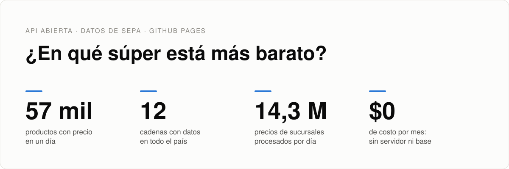
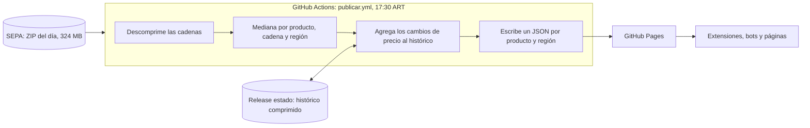

<picture>
  <source media="(prefers-color-scheme: dark)" srcset="docs/img/dark/banner.svg">
  
</picture>

<p align="center">
  <a href="https://hysmarcos.github.io/superprecios-claros/"></a>
</p>

<p align="center">
  <a href="https://github.com/hysmarcos/superprecios-claros/actions/workflows/publicar.yml"></a>
  
  
  
  
  
</p>

Todos los días, los supermercados de Argentina informan al Estado el precio de cada producto en cada sucursal. El Estado publica esos datos en [SEPA](https://datos.produccion.gob.ar/dataset/sepa-precios), en un ZIP de 324 MB con 14 millones de filas. Este proyecto convierte ese ZIP en una API abierta. Cada producto tiene un archivo JSON con el precio en cada cadena, por región, y su histórico.

La API no tiene servidor ni base de datos. Un workflow de GitHub Actions arma los archivos una vez por día y GitHub Pages los publica. El costo es $0.

## En 30 segundos

La pregunta: ¿en qué cadena está más barato este producto, y cómo cambió su precio?

> [!TIP]
> Abrí [`/v1/sku/7790139101169/NACIONAL.json`](https://hysmarcos.github.io/superprecios-claros/v1/sku/7790139101169/NACIONAL.json). Es un vinagre Favinco de 500 ml. El 2 de noviembre de 2026 costaba $ 2.000 en Coto, $ 2.150 en Disco y $ 2.250 en la Cooperativa Obrera.

| Dato | Valor |
|---|---|
| Productos con precio | 56.931 (2 de noviembre de 2026) |
| Cadenas con datos | 12 de las 15 configuradas |
| Regiones | NACIONAL, AMBA, CENTRO, CUYO, NEA, NOA y PATAGONIA |
| Actualización | Todos los días a las 17:30, hora de Argentina |
| Histórico | Desde el 2 de noviembre de 2026: 7 días completos y los lunes hacia atrás |
| Costo | $0, porque GitHub Actions y GitHub Pages son gratis en repositorios públicos |
| Autenticación | No hace falta. Cualquier página puede leer la API (CORS abierto). |

## Qué vas a encontrar

| Si querés... | Leé |
|---|---|
| Usar la API | [Usar la API](#3-usar-la-api) |
| Saber de dónde salen los precios | [El problema](#1-el-problema) y [Cómo funciona](#2-cómo-funciona) |
| Saber cuánto confiar en los datos | [¿Se puede confiar en los datos?](#4-se-puede-confiar-en-los-datos) |
| Saber cuánto cuesta y dónde están los límites | [Costos y límites](#5-costos-y-límites) |
| Ejecutar el proyecto | [Cómo está armado](#6-cómo-está-armado) y [Cómo ejecutar](#7-cómo-ejecutar) |
| Entender un término | [Glosario](#glosario) |

## 1. El problema

SEPA es la fuente oficial de precios, pero es difícil de usar directamente:

1. El archivo del día pesa 324 MB. Adentro hay un ZIP por cadena, y cada uno tiene archivos CSV separados por `|`.
2. Hay una fila por producto y por sucursal: 14,3 millones de filas el 2 de noviembre de 2026. Para saber el precio de un producto en una cadena, hay que resumir cientos de sucursales.
3. Algunos datos vienen mal cargados. Hay precios de $ 0,30 o de $ 13 millones en alguna sucursal.
4. Coto informa el [EAN](#glosario) en otra columna que las demás cadenas.
5. SEPA publica solo el día actual. No guarda el histórico.

Este proyecto resuelve los cinco puntos y publica el resultado en archivos chicos, uno por producto y región.

## 2. Cómo funciona

El diagrama muestra el recorrido diario de los datos:



Cada paso toma una decisión:

| Paso | Decisión | Motivo |
|---|---|---|
| Precio de una cadena | [Mediana](#glosario) de sus sucursales, no el promedio | La mediana ignora los precios mal cargados. |
| [Precio efectivo](#glosario) | Precio de promoción si el 30% de las sucursales o más tiene una promoción vigente | Una promoción en pocas sucursales no representa a la cadena. |
| Cadenas | Cada [bandera](#glosario) es una cadena aparte | Jumbo, Disco y Vea son de Cencosud, pero sus precios son distintos. |
| Fecha de los datos | Sale del nombre de los archivos de SEPA, no del reloj | Si SEPA no actualiza un día, la API no muestra datos viejos como nuevos. |
| Histórico | Solo guarda los días en que el precio cambió ([delta-only](#glosario)) | Reduce el tamaño. El cliente completa los días sin cambio con el precio anterior. |
| Retención | Guarda 7 días completos y los lunes hacia atrás. Nunca borra el último precio. | Mantiene el histórico chico sin perder el precio actual. |
| Estado entre corridas | El histórico vive en un asset del release `estado`, no en git | Reemplazar el archivo cada día no hace crecer el repositorio. |

GitHub Pages no ejecuta código. Por eso no hay búsqueda ni filtros por parámetros: cada consulta es una URL fija.

## 3. Usar la API

La URL base es `https://hysmarcos.github.io/superprecios-claros`. Cada endpoint es un archivo que termina en `.json`.

Leé el manifest. Tiene la fecha de los datos, las cadenas y las regiones:

```bash
curl https://hysmarcos.github.io/superprecios-claros/v1/manifest.json
```

Pedí un producto por su EAN y su región. La respuesta tiene el precio en cada cadena y el histórico:

```bash
curl https://hysmarcos.github.io/superprecios-claros/v1/sku/7790139101169/NACIONAL.json
```

Pedí un listado liviano. Trae todos los productos cuyo EAN termina en `69`, sin histórico:

```bash
curl https://hysmarcos.github.io/superprecios-claros/v1/skus/NACIONAL/69.json
```

| Endpoint | Qué devuelve |
|---|---|
| `/v1/manifest.json` | Fecha de los datos, `version_tag`, cadenas con su cantidad de productos y regiones |
| `/v1/sku/{ean}/{region}.json` | Un producto: precio en cada cadena, mínimo de 90 días, variación de 7 días e histórico |
| `/v1/skus/{region}/{shard}.json` | Listado liviano de los productos cuyo EAN termina en `{shard}` (dos dígitos, de `00` a `99`) |
| `/v1/health.json` | Fecha y hora de la última actualización |

`{region}` va en mayúsculas: `NACIONAL`, `AMBA`, `CENTRO`, `CUYO`, `NEA`, `NOA` o `PATAGONIA`.

Si el producto no tiene precio ese día en esa región, la respuesta es 404 con un cuerpo HTML. Mirá el código de estado, no el cuerpo.

<details>
<summary>Ver el formato de <code>/v1/sku/{ean}/{region}.json</code></summary>

Fragmento real del 2 de noviembre de 2026. `precios` viene ordenado del más barato al más caro:

```json
{
  "ean": "7790139101169",
  "producto": { "nombre": "VINAGRE DE VINO FAVINCO BOT 500 ML", "marca": "FAVINCO", "cantidad": 500, "unidad": "ml" },
  "region": "NACIONAL",
  "fecha": "2026-11-02",
  "precios": [
    {
      "cadena": { "id": 1, "nombre": "Coto", "grupo": "Coto", "logo_url": null },
      "precio_lista": 2000,
      "precio_efectivo": 2000,
      "promo": null,
      "min_90d": 2000,
      "min_90d_fecha": "2026-11-02",
      "delta_7d_pct": null,
      "is_min_historico": true
    }
  ],
  "historico": {
    "1": [{ "fecha": "2026-11-02", "precio_lista": 2000, "precio_efectivo": 2000, "promo": null }]
  }
}
```

| Campo | Qué es |
|---|---|
| `precio_lista` | Mediana del precio de lista en las sucursales de la cadena |
| `precio_efectivo` | Precio con la promoción vigente, si la promoción es representativa. Si no, el precio de lista. |
| `promo` | Texto y fecha de fin de la promoción, o `null` |
| `min_90d`, `min_90d_fecha` | Precio efectivo más bajo de los últimos 90 días y su fecha |
| `delta_7d_pct` | Variación del precio efectivo contra hace 7 días, en %. Es `null` si no hay dato de hace 7 días. |
| `is_min_historico` | `true` si el precio de hoy es el más bajo de los últimos 90 días |
| `historico` | Puntos por `cadena_id`. Solo aparecen los días en que el precio efectivo cambió. |

Para dibujar un gráfico, repetí cada precio hasta el punto siguiente (gráfico escalonado).

</details>

<details>
<summary>Ver el formato de <code>/v1/skus/{region}/{shard}.json</code></summary>

`items` usa el EAN como clave. Para buscar varios productos, agrupá los EAN por sus dos últimos dígitos y bajá un archivo por grupo:

```json
{
  "region": "NACIONAL",
  "fecha": "2026-11-02",
  "items": {
    "7790139101169": {
      "producto": { "nombre": "VINAGRE DE VINO FAVINCO BOT 500 ML", "marca": "FAVINCO" },
      "por_cadena": {
        "1": { "precio_efectivo": 2000, "delta_7d_pct": null, "is_min_historico": true, "tiene_promo": false },
        "3": { "precio_efectivo": 2150, "delta_7d_pct": null, "is_min_historico": true, "tiene_promo": false }
      },
      "cadena_min": { "id": 1, "precio": 2000 }
    }
  }
}
```

Si un EAN no está en `items`, ese producto no tiene precio ese día en esa región.

</details>

<details>
<summary>Ver cómo calcular una canasta en el cliente</summary>

GitHub Pages no acepta un `POST`. La canasta se calcula en el navegador con los listados:

```js
const BASE = 'https://hysmarcos.github.io/superprecios-claros';

async function canasta(eans, region = 'NACIONAL') {
  const shards = [...new Set(eans.map((e) => e.slice(-2)))];
  const archivos = await Promise.all(
    shards.map((s) => fetch(`${BASE}/v1/skus/${region}/${s}.json`).then((r) => r.json())),
  );
  const items = Object.assign({}, ...archivos.map((a) => a.items));
  const totales = {};
  for (const ean of eans) {
    for (const [cadena, p] of Object.entries(items[ean]?.por_cadena ?? {})) {
      totales[cadena] ??= { cadena_id: Number(cadena), total: 0, skus_disponibles: 0 };
      totales[cadena].total += p.precio_efectivo;
      totales[cadena].skus_disponibles++;
    }
  }
  // Primero las cadenas que tienen todos los productos, después la más barata
  return Object.values(totales)
    .map((t) => ({ ...t, skus_faltantes: eans.length - t.skus_disponibles }))
    .sort((a, b) => a.skus_faltantes - b.skus_faltantes || a.total - b.total);
}
```

Los nombres de las cadenas están en `manifest.json`, en `cadenas`.

</details>

<details>
<summary>Ver las cadenas y su <code>cadena_id</code></summary>

| Cadena | Grupo | `cadena_id` |
|---|---|---|
| Coto | Coto | 1 |
| Vea, Disco, Jumbo | Cencosud | 2, 3, 4 |
| Hiper Carrefour, Carrefour Market, Express y Maxi | Carrefour | 5 a 8 |
| DIA | DIA | 9 |
| La Anónima, Topsy, Bomba | La Anónima | 10 a 12 |
| Cooperativa Obrera | Cooperativa Obrera | 13 |
| Hipermercado Libertad | Libertad | 14 |
| Toledo | Toledo | 15 |

Una cadena con `skus_count: 0` en el manifest no vino en el archivo de SEPA de ese día. Para sumar una cadena, agregala al final de `src/db/cadenas.ts`.

</details>

GitHub Pages manda `Cache-Control: max-age=600`, es decir 10 minutos de caché. Los datos cambian una vez por día. Si tu cliente usa un caché más largo, agregá `?v=<version_tag>` a cada URL. `version_tag` está en el manifest y cambia con cada fecha de datos.

## 4. ¿Se puede confiar en los datos?

Estas pruebas buscan dónde falla el proceso:

| | Prueba | Pregunta | Resultado |
|:---:|---|---|---|
| ✅ | Tests sin base de datos | ¿El histórico, las métricas y los archivos salen bien? | 40 tests, entre ellos el build completo con un fixture de Coto |
| ✅ | Corrida repetida | ¿Correr dos veces el mismo día cambia algo? | No. El precio de hoy se reemplaza y el resultado es el mismo. |
| ✅ | Fecha de SEPA | ¿Puede publicar datos viejos como nuevos? | No. Si SEPA trae una fecha anterior a la última corrida, el build se detiene. |
| ✅ | Corrida en GitHub | ¿SEPA acepta descargas desde GitHub Actions? | Sí. El primer build tardó 2 min 29 s y el deploy 42 s. |
| ⚠️ | Regiones | ¿AMBA es el Gran Buenos Aires? | No. AMBA solo incluye CABA. El resto de la provincia de Buenos Aires cae en CENTRO. |
| ⚠️ | Promociones | ¿El precio efectivo es el que paga cualquier cliente? | No siempre. Una promoción puede pedir una tarjeta o una cantidad mínima. La API da el texto de la promoción, pero no lo interpreta. |

Los datos son los que las cadenas informan a SEPA. Este proyecto no los compara con los precios de las góndolas.

## 5. Costos y límites

El costo mensual es $0. GitHub Actions es gratis para repositorios públicos, y GitHub Pages también.

| Límite de GitHub | Valor | Uso medido el 2 de noviembre de 2026 |
|---|---|---|
| Tamaño del sitio en Pages | 1 GB | 358 MB en 286.031 archivos |
| Ancho de banda de Pages | 100 GB por mes (límite blando) | Sin medir |
| Tiempo de deploy en Pages | 10 minutos | 42 segundos |
| Cron en repositorios públicos | Se apaga tras 60 días sin actividad | El workflow lo vuelve a habilitar en cada corrida |

El sitio crece con el histórico. Si pasa de 900 MB, el build publica menos semanas de histórico (52, 39, 26, 13 o 4) hasta que entre. El release `estado` guarda el histórico completo.

## 6. Cómo está armado

| Carpeta | Contenido |
|---|---|
| `src/ingesta/` | Descarga, descompresión, lectura de CSV, EAN, regiones, mediana y promociones |
| `src/static/` | Histórico, retención, métricas y escritura de los archivos JSON |
| `src/api/` | API con servidor (Hono), para correr con Postgres |
| `src/db/` | Esquema de Postgres y catálogo de cadenas |
| `tests/` | Tests de Vitest y el fixture de Coto |
| `.github/workflows/` | `publicar.yml`: build diario y deploy a GitHub Pages |

La API con servidor sigue en el repositorio. Usa Postgres y Hono, responde formatos parecidos y agrega `POST /v1/basket`. Los dos modos comparten el código de lectura y normalización (`src/ingesta/aggregate.ts`).

## 7. Cómo ejecutar

Necesitás Node 22 y el comando `unzip`. Desde la carpeta del repositorio, instalá las dependencias y compilá:

```bash
npm install
```

```bash
npm run build
```

Armá la API estática. El comando baja el ZIP del día, escribe los archivos en `site/` y guarda el histórico en `state/`. El workflow le da a Node hasta 12 GB de memoria, y este ejemplo hace lo mismo:

```bash
NODE_OPTIONS=--max-old-space-size=12288 npm run build:static -- --out site --state state
```

Si ya tenés el ZIP, pasalo con `--zip`:

```bash
npm run build:static -- --zip sepa_lunes.zip --out site --state state
```

Corré los tests que no usan base de datos:

```bash
npx vitest run tests/static-historico.test.ts tests/static-site.test.ts tests/median.test.ts tests/parser.test.ts tests/promo-parser.test.ts tests/region-mapper.test.ts tests/ean-adapter.test.ts
```

<details>
<summary>Ver cómo correr la API con servidor y Postgres</summary>

Necesitás también Docker. Levantá Postgres en el puerto 15432 y creá el archivo `.env`:

```bash
docker compose up -d postgres
```

```bash
cp .env.example .env
```

Aplicá las migraciones y cargá las cadenas:

```bash
npm run db:migrate
```

```bash
npx tsx src/db/seed.ts
```

Cargá los precios del día y levantá la API en `http://localhost:3000/v1/health`:

```bash
npm run dev:ingesta
```

```bash
npm run dev:api
```

Con Postgres levantado, `npm test` corre todos los tests, también los de la API y el E2E.

| Variable | Valor por defecto | Qué es |
|---|---|---|
| `DATABASE_URL` | Sin valor | Conexión a Postgres. La usan la API y la ingesta a Postgres. |
| `PORT` | `3000` | Puerto de la API |
| `NODE_ENV` | `development` | `development` muestra los logs en formato legible |
| `LOG_LEVEL` | `info` | Nivel de log de Pino |
| `SEPA_BASE_URL` | URL oficial | URL alternativa para bajar el ZIP |
| `INGESTA_TMP_DIR` | `/tmp/sepa` | Carpeta donde se baja y se descomprime el ZIP |

</details>

## Próximos pasos

1. Publicar un índice por nombre, para buscar productos sin conocer el EAN.
2. Separar el Gran Buenos Aires del resto de la provincia con la localidad de cada sucursal.
3. Detectar descuentos falsos: precios que suben antes de una promoción.

## Glosario

| Término | Qué es | Para leer más |
|---|---|---|
| Bandera | Marca comercial de una cadena. Un mismo grupo puede tener varias. | [SEPA](https://datos.produccion.gob.ar/dataset/sepa-precios) |
| CORS | Permiso del servidor para que otra página lea sus datos desde el navegador. | [MDN](https://developer.mozilla.org/es/docs/Web/HTTP/CORS) |
| Delta-only | Histórico que guarda solo los días en que el valor cambió. | |
| EAN | Código de barras de un producto, de 8 a 14 dígitos. | [Wikipedia](https://es.wikipedia.org/wiki/European_Article_Number) |
| GitHub Actions | Servicio de GitHub que ejecuta tareas programadas o por evento. | [GitHub](https://docs.github.com/es/actions) |
| GitHub Pages | Servicio de GitHub que publica archivos estáticos en una URL. | [GitHub](https://docs.github.com/es/pages) |
| Mediana | Valor del medio cuando se ordenan los datos. Los extremos no la mueven. | [Wikipedia](https://es.wikipedia.org/wiki/Mediana_(estad%C3%ADstica)) |
| Precio efectivo | Precio con la promoción vigente, si la promoción es representativa. | |
| SEPA | Sistema Electrónico de Publicidad de Precios Argentinos. | [datos.produccion.gob.ar](https://datos.produccion.gob.ar/dataset/sepa-precios) |
| Shard | Parte de un listado. Acá, los productos con los mismos dos últimos dígitos de EAN. | |

## Fuente de los datos y licencia

Los precios vienen de [SEPA](https://datos.produccion.gob.ar/dataset/sepa-precios), que publica el Ministerio de Economía con licencia CC-BY. Esta API resume los datos por región (mediana, variación y mínimo de 90 días) sin cambiar su contenido. Si usás la API, citá a SEPA como fuente.

El código de este repositorio tiene licencia MIT.
